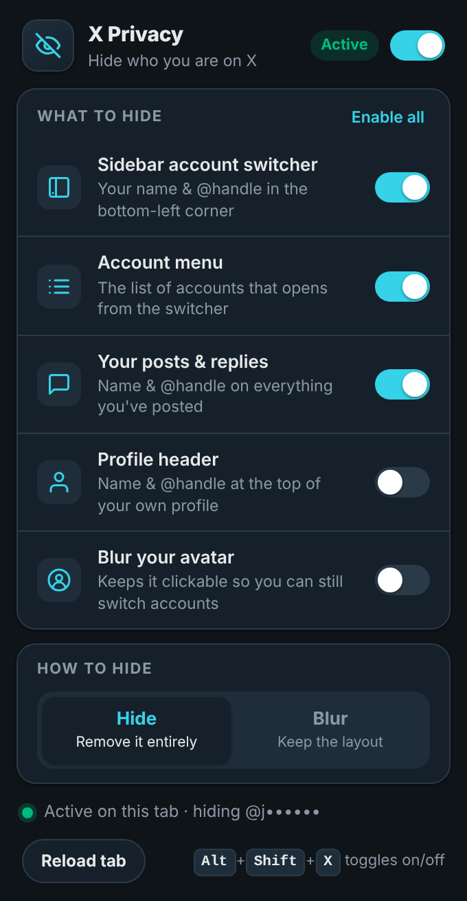
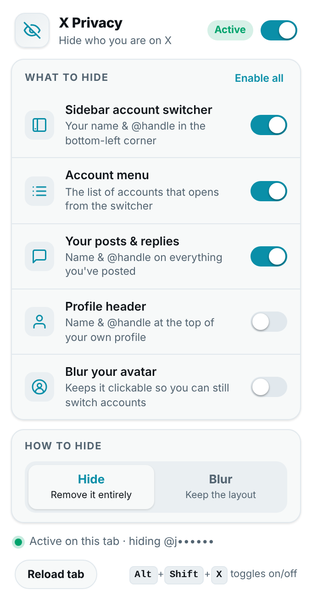

# X Privacy

Chrome extension that hides **your display name, @handle and (optionally) your avatar** on [x.com](https://x.com), so you can screen share, stream or demo X without showing who you are.

**[Install from the Chrome Web Store](https://chromewebstore.google.com/detail/x-privacy/hfailpkhbdhkmlgpogmdogdghfacjomm)** — or [load it unpacked](#install-unpacked).

<p align="center">
  
  &nbsp;&nbsp;
  
</p>

## What it hides

| Toggle | What disappears | Default |
| --- | --- | --- |
| **Sidebar account switcher** | Your name and @handle in the bottom-left corner. The avatar stays so you can still open the menu. | on |
| **Account menu** | Names and handles of every account in the menu that opens from the switcher, including the handle in "Log out @you". | on |
| **Your posts & replies** | Your name and @handle on everything you've posted, in any timeline, thread or hover card. Other people's posts are untouched. | off |
| **Profile header** | Your name and @handle at the top of your own profile page. | off |
| **Blur your avatar** | Blurs your profile picture everywhere it appears. It stays clickable. | off |

## How it hides

- **Hide** removes the text entirely (the sidebar collapses to just the avatar).
- **Blur** blurs it in place so the layout doesn't shift. Optionally **reveal on hover** to read it yourself without turning anything off.

## More

- **Keyboard shortcut** — `Alt+Shift+X` pauses and resumes the extension. The toolbar icon shows an `OFF` badge while paused. Change the key at `chrome://extensions/shortcuts`.
- **Live status** — the popup tells you whether it's active on the current tab and which account it's hiding (shown masked, e.g. `@j•••••`).
- **Enable all** — one click turns every toggle on; click again to go back to the defaults.
- **Light and dark** — the popup follows your system theme.
- **Settings sync** through your Chrome profile. Nothing is collected or sent anywhere; the only permissions are `storage` and access to `x.com` / `twitter.com`.

## Install (unpacked)

1. Download `x-privacy-v<version>.zip` from the [latest release](../../releases/latest) and unzip it (or clone this repository).
2. Open `chrome://extensions/` and turn on **Developer mode** (top right).
3. Click **Load unpacked** and select the `X-Privacy` folder.
4. Open or reload `https://x.com`.

## What it doesn't hide

- Mentions of you inside *other people's* posts (those are their words, and hiding them would look like censorship of the thread).
- Your handle in the address bar when you open your own profile.
- Account details on settings pages (email, phone).
- X Pro (pro.x.com) and the mobile apps.

If X changes its layout and something slips through, reload the tab first; the extension re-applies itself as X re-renders. If it keeps happening, [open an issue](../../issues).

## How it works

- `content.js` learns your handle from the account switcher's avatar (`data-testid="UserAvatar-Container-<handle>"`), falling back to the **Profile** link in the navigation and finally the `@handle` text itself.
- It marks the elements to hide with `data-xp-m-*` attributes. `styles.css` does the actual hiding, gated by feature flags on `<html>`, so toggling a setting is instant and nothing needs to be undone.
- A throttled `MutationObserver` keeps the marks fresh while X re-renders. Attribute changes aren't observed, so the extension never reacts to its own work.
- `background.js` seeds defaults on install, keeps the badge in sync and handles the keyboard shortcut.

## Development

There is no build step; edit the files and reload the extension.

```bash
npm install                      # Playwright, for the tests
npx playwright install chromium

npm test                         # run the checks against test/fixture.html (a mock of X's DOM)
npm run shots                    # same, and refresh docs/popup*.png
npm run zip                      # build dist/x-privacy-v<version>.zip for the Web Store
```

To publish a release, bump `version` in `manifest.json` (and `package.json`), add notes to `.github/release-notes/v<version>.md`, then push a matching tag. The **Release** workflow builds the zip and publishes the GitHub release with it attached.

`test/fixture.html` imitates the parts of X's DOM the extension cares about (sidebar switcher, account menu, timeline, profile header). `test/run.mjs` loads the real `content.js` and `styles.css` into it with a stubbed `chrome.*` API and checks what ends up hidden, blurred or left alone, then does the same for the popup.

## Files

| File | Purpose |
| --- | --- |
| `manifest.json` | Manifest V3 |
| `content.js` | Detects your handle, marks elements, watches for re-renders |
| `styles.css` | All hiding/blurring rules |
| `background.js` | Defaults, badge, keyboard shortcut |
| `popup.html` / `popup.css` / `popup.js` | The settings popup |
| `icons/` | Toolbar icons |
| `test/` | DOM fixture, `chrome.*` stub and Playwright checks |
| `scripts/package.sh` | Builds the Web Store zip |

## Changelog

### 2.0.0

- New popup with per-feature toggles, Hide/Blur modes, live tab status, light/dark themes.
- Hide your identity in the account menu, on your own posts and replies, and on your profile header.
- Blur your avatar.
- `Alt+Shift+X` shortcut and `OFF` badge.
- Rewritten content script: handle detection, throttled observer, survives account switches.
- Test suite and packaging script. Icons restored to the repository.

### 1.0.0

- Hide your name and @handle in the sidebar account switcher.
